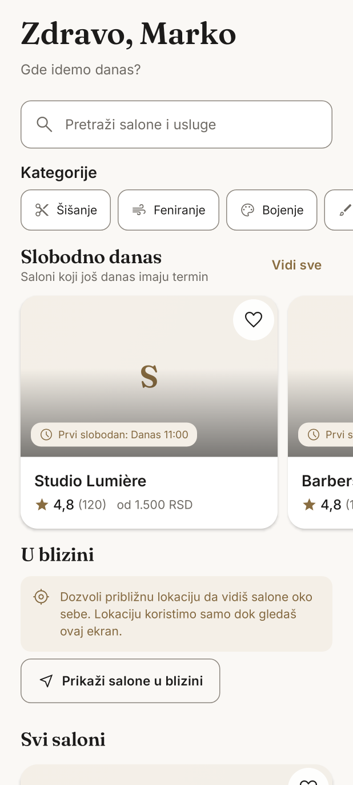
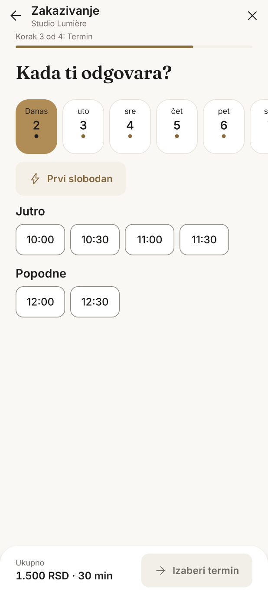
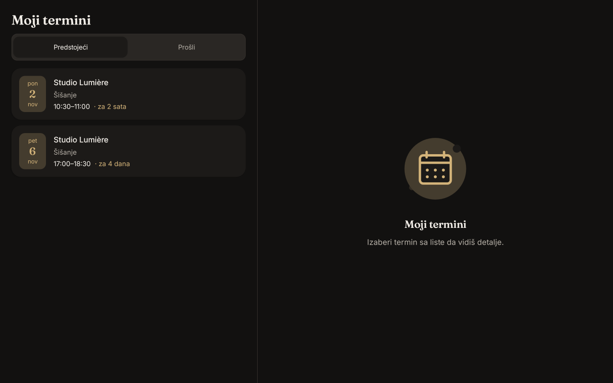

# Termin

Aplikacija za zakazivanje termina u frizerskim salonima (Srbija): klijenti pronalaze salon i zakazuju,
vlasnici vode salon, tim i kalendar, a frizeri svoj raspored. Android (Kotlin, Jetpack Compose) +
Firebase (Auth, Firestore, Storage, Cloud Functions, Cloud Messaging).

| Početna | Zakazivanje | Moji termini (tablet) |
|---|---|---|
|  |  |  |

## Demo za 4 komande

Demo radi bez ijednog naloga i ključa: Firebase Emulator Suite (projekat `demo-termin`) i seed podaci.

Potrebno: **Node.js 22+**, **Java 21+**, **Android SDK** (Android Studio) i pokrenut **Android emulator**.

```bash
npm install
npm run demo                 # emulatori + seed; ostavi da radi (Ctrl+C zaustavlja)
cd android                   # u drugom terminalu
./gradlew installDebug       # instalira aplikaciju na emulator
```

U aplikaciji: preskoči uvod, pa na ekranu prijave izaberi **Brza demo prijava** → *Klijent*, *Vlasnik* ili
*Frizer*. Može i ručno, brojem telefona — SMS kod se vidi u Emulator UI
(<http://127.0.0.1:4000/auth>):

| Uloga | Telefon |
|---|---|
| Klijent | +381 60 0000001 |
| Vlasnik salona | +381 60 0000002 |
| Frizer | +381 60 0000003 |

Seed pravi 3 salona u Beogradu (2–4 frizera, 6–10 usluga sa cenama u RSD, radno vreme, recenzije, prošli i
budući termini, fotografije i akcentne boje). „Google“ prijava u demo režimu ide preko Auth emulatora
(upisuje se e-pošta probnog naloga). Push obaveštenja ne rade u emulatoru, ali lokalni podsetnici rade.
Bez Google Maps ključa umesto mape stoji poruka, lista i „Otvori u Google Mapama“.

Provera scenarija iz specifikacije nad pokrenutim demoom (zakazivanje kod „bilo kog frizera“, dva korisnika
na isti slot, otkazivanje, blokada vremena, ručni unos, recenzija):

```bash
npm run smoke
```

**Fizički telefon** umesto emulatora: u `firebase.json` promeni `host` emulatora u `0.0.0.0`, pa
`./gradlew installDebug -Ptermin.emulatorHost=<IP adresa računara>`.

## Testovi

```bash
npm test                                   # Functions: dostupnost, istovremeni hold, pravila, integracije (na emulatorima)
npm run lint                               # ESLint + TypeScript
cd android
./gradlew lintDebug                        # lint, upozorenja su greške
./gradlew verifyRoborazziDebug             # unit, UI, cela aplikacija (Hilt + lažni backend) i 78 snimaka ekrana
./gradlew recordRoborazziDebug             # ponovno snimanje referentnih snimaka (posle namerne izmene izgleda)
./gradlew :baselineprofile:connectedBenchmarkReleaseAndroidTest   # Macrobenchmark (uređaj + `npm run demo`)
./gradlew :app:generateBaselineProfile     # baseline profil (uređaj + `npm run demo`)
```

CI (GitHub Actions) pokreće isto: `.github/workflows/android.yml` i `.github/workflows/functions.yml`.

## Prelazak na produkciju

1. **Firebase projekat.** Napravi projekat u [Firebase konzoli](https://console.firebase.google.com) i
   uključi **Blaze** plan (Cloud Functions i Secret Manager ga zahtevaju). Firestore napravi u regionu
   `eur3` (ili `europe-west1`), uključi Cloud Storage.
2. **Android aplikacija u projektu.** Dodaj Android aplikaciju sa paketom `rs.termin.app` (i
   `rs.termin.app.debug` za razvoj), sa SHA-1 i SHA-256 otiscima ključa za potpis (Play App Signing i
   upload ključ). Preuzmi `google-services.json` i zameni `android/app/google-services.json`.
   U `.firebaserc` upiši id projekta umesto `demo-termin`.
3. **Prijava.** Authentication → Sign-in method: uključi **Phone** i **Google**. Web client ID iz Google
   provajdera upiši u `android/local.properties`:
   ```properties
   GOOGLE_WEB_CLIENT_ID=123456789-abc.apps.googleusercontent.com
   ```
4. **Google Maps.** U [Google Cloud konzoli](https://console.cloud.google.com) uključi *Maps SDK for
   Android*, napravi API ključ ograničen na paket i SHA-1, i upiši ga u `android/local.properties`:
   ```properties
   MAPS_API_KEY=AIza...
   ```
5. **App Check.** App Check → registruj aplikaciju za **Play Integrity**; uključi enforcement za Cloud
   Functions, Firestore i Storage. Za razvoj nad pravim projektom:
   `./gradlew installDebug -Ptermin.useEmulators=false`, pa debug token iz logcat-a dodaj u App Check.
6. **Parametri funkcija.** Napravi `functions/.env.<id-projekta>`:
   ```properties
   PUBLIC_FUNCTIONS_URL=https://europe-west1-<id-projekta>.cloudfunctions.net
   APP_DEEP_LINK_BASE=termin://integrations
   GOOGLE_OAUTH_CLIENT_ID=
   CALENDLY_CLIENT_ID=
   CALCOM_CLIENT_ID=
   ```
7. **Tajne** (samo na serveru, nikad u aplikaciji):
   ```bash
   npx firebase functions:secrets:set TOKEN_ENCRYPTION_KEY      # vrednost: openssl rand -base64 32
   npx firebase functions:secrets:set GOOGLE_OAUTH_CLIENT_SECRET
   npx firebase functions:secrets:set CALENDLY_CLIENT_SECRET
   npx firebase functions:secrets:set CALENDLY_WEBHOOK_SIGNING_KEY
   npx firebase functions:secrets:set CALCOM_CLIENT_SECRET
   npx firebase functions:secrets:set CALCOM_WEBHOOK_SECRET
   ```
   Za integraciju koju ne koristiš upiši vrednost `not-configured`; aplikacija je tada prikazuje kao
   nedostupnu.
8. **OAuth klijenti za kalendare** (redirect URI svuda: `<PUBLIC_FUNCTIONS_URL>/oauthCallback`):
   - **Google Calendar**: Google Cloud → uključi *Google Calendar API*; OAuth consent screen sa opsezima
     `calendar.events` i `calendar.freebusy`; OAuth client tipa *Web application*. Client ID →
     `GOOGLE_OAUTH_CLIENT_ID`, secret → `GOOGLE_OAUTH_CLIENT_SECRET`.
   - **Calendly**: [developer.calendly.com](https://developer.calendly.com) → OAuth aplikacija; Client ID →
     `CALENDLY_CLIENT_ID`, secret i webhook signing key → tajne. Webhook pretplatu pravi server pri
     povezivanju.
   - **Cal.com**: Cal.com → Settings → Developer → OAuth client; Client ID → `CALCOM_CLIENT_ID`, secret →
     `CALCOM_CLIENT_SECRET`; tajna za webhookove → `CALCOM_WEBHOOK_SECRET`.
9. **Deploy** pravila, indeksa, funkcija i hostinga:
   ```bash
   npx firebase login
   npx firebase use <id-projekta>
   npm run build
   npx firebase deploy --only firestore,storage,functions,hosting
   ```
10. **App Links za deljene linkove salona** (`https://<id-projekta>.web.app/s/{id}`):
    ```bash
    node scripts/assetlinks.mjs <SHA-256 otisak ključa za potpis iz Play Console-a>
    npx firebase deploy --only hosting
    ```
11. **Release build.** Ključ za potpis (upload ključ za Play App Signing) pravi se jednom i čuva van
    repozitorijuma, uz rezervnu kopiju:
    ```bash
    keytool -genkeypair -v -keystore ~/termin-upload.jks -alias termin -keyalg RSA -keysize 4096 -validity 10000
    ```
    Putanja i lozinke idu u promenljive okruženja ili `android/local.properties`:
    ```properties
    TERMIN_KEYSTORE=/home/<korisnik>/termin-upload.jks
    TERMIN_KEYSTORE_PASSWORD=...
    TERMIN_KEY_ALIAS=termin
    TERMIN_KEY_PASSWORD=...
    ```
    Bez ovih vrednosti release se potpisuje debug ključem (samo za lokalnu proveru, Play ga odbija).
    Zatim:
    ```bash
    cd android
    TERMIN_CRASHLYTICS_UPLOAD=true ./gradlew bundleRelease
    ```
    `app/build/outputs/bundle/release/app-release.aab` se šalje u Play Console (podaci za stranicu i Data
    Safety su u [docs/PLAY_STORE.md](docs/PLAY_STORE.md)).
12. **Prvi salon.** U produkciji nema seed-a: vlasnik se prijavi, u Profilu izabere „Otvori svoj salon u
    Terminu“, unese usluge, tim, radno vreme i fotografije, pa uključi „Objavi salon“.

## Dokumentacija

- [docs/ARCHITECTURE.md](docs/ARCHITECTURE.md) — slojevi, model podataka, zakazivanje, obaveštenja, integracije
- [docs/API.md](docs/API.md) — Cloud Functions: ulazi, izlazi, greške, ograničenja
- [docs/DECISIONS.md](docs/DECISIONS.md) — odluke tamo gde zadatak nije bio precizan
- [docs/PERFORMANCE.md](docs/PERFORMANCE.md) — veličina, brzina, merenja
- [docs/PLAY_STORE.md](docs/PLAY_STORE.md) — naziv, opisi, Data Safety
