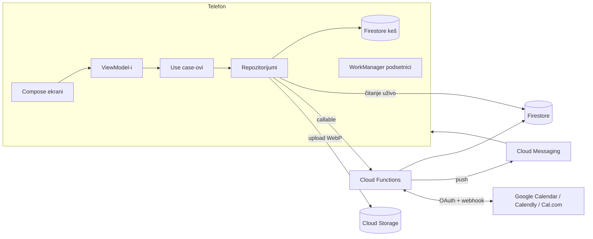

# Arhitektura

Termin se sastoji od Android aplikacije i Firebase backenda. Aplikacija čita podatke direktno iz
Firestore-a (uz pravila po ulogama), a sve što menja termine ide preko Cloud Functions, gde se u
transakciji proveravaju pravila salona i zauzetost.

## Repozitorijum

| Putanja | Sadržaj |
|---|---|
| `android/` | Gradle projekat: `:app` (aplikacija) i `:baselineprofile` (Macrobenchmark, baseline profil) |
| `functions/` | Cloud Functions (TypeScript, 2. generacija), testovi (Vitest) |
| `seed/` | Seed skripta, podaci i slike za demo |
| `scripts/` | `demo.mjs` (demo jednom komandom), `smoke.mjs` (provera scenarija), `assetlinks.mjs` |
| `hosting/public/` | Stranica za deljene linkove salona (`/s/{id}`) |
| `firestore.rules`, `storage.rules`, `firestore.indexes.json`, `firebase.json` | Firebase konfiguracija |
| `docs/` | Ova dokumentacija |
| `.github/workflows/` | CI za Android i Functions |

## Android aplikacija

Jedan `:app` modul, paketi po celinama (`rs.termin.app`):

| Paket | Uloga |
|---|---|
| `core/designsystem` | `ThemeConfig.kt` (svi izbori iz odeljka 0 na jednom mestu), tokeni (boje, tipografija, razmaci, zaobljenja, površine, pokret), komponente (dugmad, kartice, polja, chipovi, trake, skeleton, prazna stanja) |
| `core/domain` | Modeli, pravila zakazivanja (`BookingRules.kt`), interfejsi repozitorijuma, use case-ovi, `StaffSession` |
| `core/data` | Firebase implementacije repozitorijuma, mapiranje dokumenata, DataStore, lokacija, mreža, upload slika, obaveštenja i podsetnici |
| `core/ui` | Zajednički elementi ekrana (formatiranje, kartice salona i termina, izbor datuma/vremena/lokacije) |
| `feature/*` | Ekrani i ViewModel-i: `onboarding`, `auth`, `home`, `search`, `salon`, `booking`, `appointments`, `inbox`, `profile`, `calendar`, `staff`, `owner`, `debug` |
| `navigation` | Tipizovane rute, `TerminNavHost` (sve destinacije i deep linkovi), `MainScaffold` (donja/bočna traka) |

### Tok podataka

- **UDF**: ekran prikazuje `UiState` iz `StateFlow`-a i šalje događaje ViewModel-u. Ekrani imaju
  „Content“ funkcije bez ViewModel-a, koje koriste UI testovi i snimci ekrana.
- **Čitanje** ide preko Firestore snapshot listener-a (`Flow`), sa offline kešom; liste se učitavaju po 20.
  Listener-i rade samo dok je ekran vidljiv (`WhileSubscribed(5 s)`).
- **Pisanje termina** ide isključivo preko callable funkcija (`FunctionsClient`), sa ponovnim pokušajem i
  postepenim odlaganjem za čitanja; greške servera postaju `BookingError` sa porukom na srpskom.
- **Faze aplikacije** (`AppViewModel`): učitavanje → uvod → prijava → (usklađivanje naloga) → podešavanje
  profila → glavni deo. Uloga iz tokena određuje prikaz: klijent (Početna, Pretraga, Termini, Profil) ili
  salon (Kalendar, Termini, Salon, Profil).
- **Deep linkovi** (`termin://salon/{id}`, `termin://book/{salonId}?services&stylist&date`,
  `termin://appointment/{id}`, `termin://inbox`, `termin://integrations?...`,
  `https://<projekat>.web.app/s/{id}`) čekaju u `AppViewModel` dok glavni deo ne bude spreman (npr. posle
  prijave), pa ih obrađuje navigacija.

### Dizajn sistem

`TerminTheme` gradi boje iz palete, nijanse koju je korisnik izabrao i stila; tipografiju iz para fontova i
stila; razmake iz gustine; zaobljenja i površine (senke, ivice, obrada fotografija) iz stila; pokret iz
nivoa animacija i stanja uređaja (smanjene animacije, ušteda baterije, slab telefon). Svaka boja teksta se
proverava (≥ 4.5:1), a ivice i ikonice ≥ 3:1; tekst na akcentu je automatski beo ili taman. Akcenat
salona (`SalonAccentTheme`) važi samo na stranici salona i u toku zakazivanja.

## Backend

### Model podataka (Firestore)

| Kolekcija | Sadržaj | Ko čita / piše |
|---|---|---|
| `users/{uid}` | ime, telefon, e-pošta, fotografija, uloge, salonId/stylistId, omiljeni, jezik, obaveštenja | vlasnik naloga (deo polja) / server |
| `users/{uid}/inbox/{id}` | obaveštenja u aplikaciji | vlasnik naloga |
| `salons/{id}` | naziv, slug, opis, adresa, geo + geohash, telefon, fotografije, naslovna, akcentna boja, radno vreme, pravila, objavljen, ocena, izvedena polja (kategorije, najniža cena, ključne reči, prvi slobodan) | svi prijavljeni (objavljen) i osoblje / vlasnik (dozvoljena polja) |
| `salons/{id}/services/{id}` | kategorija, naziv, opis, trajanje, cena, frizeri, redosled, aktivna | svi / vlasnik |
| `salons/{id}/stylists/{id}` | ime, fotografija, bio, specijalnosti, portfolio, radno vreme, pauze, aktivan, ocena, integracije (stanje, bez tokena) | svi / vlasnik, frizer (svoj profil) |
| `salons/{id}/stylists/{id}/timeOff/{id}` | odsustva i blokade | osoblje / server |
| `salons/{id}/stylists/{id}/days/{GGGG-MM-DD}` | intervali zauzetosti za dan | server |
| `salons/{id}/reviews/{id}` | ocena, tekst, odgovor salona | svi / server |
| `appointments/{id}` | salon, frizer, klijent, usluge, početak/kraj, cena, status, izvor, napomena | klijent (svoj), osoblje salona / server |
| `waitlist/{id}` | lista čekanja (korisnik, salon, dan, usluge) | vlasnik unosa / server |
| `integrations`, `oauthStates`, `busyCache`, `webhookEvents`, `invites`, `rateLimits` | serverski podaci (šifrovani tokeni, OAuth stanje, keš zauzetosti, idempotentnost, pozivi, brojači) | samo server |

Storage: `salons/{id}/photos/*`, `salons/{id}/stylists/{id}/*`, `users/{uid}/*` — upis samo za vlasnika
odgovarajućeg resursa, samo slike do 5 MB.

### Zakazivanje i zaključavanje

1. `getAvailability` računa slotove za 1–14 dana: radno vreme salona ili frizera, pauze, odsustva,
   termini, hold-ovi i spoljna zauzetost iz `days` dokumenata, uz korak slotova, pauzu između termina,
   najkraće vreme do termina i horizont zakazivanja. Za „bilo kog frizera“ vraća uniju.
2. `holdSlot` u transakciji čita `days` dokumente frizera i upisuje hold od 5 minuta. Ako je slot u
   međuvremenu zauzet, vraća `SLOT_TAKEN` sa osveženim slotovima. Novi hold istog korisnika zamenjuje
   prethodni u istoj transakciji.
3. `confirmBooking` pretvara hold u potvrđen termin (dok hold važi), zakazuje podsetnike i obaveštava
   salon i frizera.
4. `cancelAppointment` / `rescheduleAppointment` proveravaju rok iz pravila salona za klijenta, oslobađaju
   interval i obaveštavaju listu čekanja.

### Obaveštenja

Svako obaveštenje se upisuje u sanduče (`users/{uid}/inbox`) i šalje kao push na sve uređaje korisnika
(FID). Podsetnici 24 h i 2 h pre termina i molba za recenziju 1 h posle šalju se periodičnom funkcijom
(svakih 5 minuta); isti podsetnici se zakazuju i lokalno (WorkManager), pa rade i bez interneta i u demo
režimu.

### Periodične funkcije

| Funkcija | Učestalost | Posao |
|---|---|---|
| `cleanupExpiredHolds` | 5 min | briše istekle hold-ove |
| `sendReminders` | 5 min | podsetnici i molbe za recenziju |
| `completePastAppointments` | 60 min | potvrđen termin 12 h posle kraja postaje „završen“ |
| `refreshCalendars` | 10 min | osvežava zauzetost spoljnih kalendara, obnavlja Google kanale |
| `refreshFirstFreeSlots` | 30 min | „prvi slobodan termin“ na karticama salona |
| `cleanupRecords` | 24 h | stare evidencije webhookova i OAuth stanja |

Okidači (`onAppointmentWritten`, `onServiceWritten`, `onStylistWritten`, `onSalonWritten`) održavaju
izvedena polja (ocena, kategorije, cene, ključne reči, prvi slobodan) i usklađuju termine sa spoljnim
kalendarima.

### Integracije kalendara

`CalendarProvider` interfejs (`getBusy`, `createEvent`, `updateEvent`, `deleteEvent`, `parseWebhook`) ima
tri implementacije: Google Calendar (API v3, push kanali), Calendly (API v2, webhook pretplata) i Cal.com
(API v2, webhook). Povezivanje: aplikacija poziva `startIntegrationOAuth`, otvara Custom Tab, provajder
vraća na `oauthCallback`, server menja kod za tokene (PKCE), šifruje ih i preusmerava na
`termin://integrations?provider=…&status=ok`. Rezervacije sa Calendly-ja i Cal.com-a ulaze kao termini
salona, a termini iz Termina se upisuju u povezani kalendar.

## Bezbednost

- Uloge su u custom claims (`roles`, `salonId`, `stylistId`), dodeljuje ih samo server.
- Firestore pravila: klijent čita objavljene salone i samo svoje termine; osoblje samo svoj salon; termini
  se ne mogu menjati iz aplikacije.
- App Check (Play Integrity) je obavezan za callable funkcije u produkciji.
- Svaki ulaz se proverava `zod` šemom; ograničenje broja zahteva po korisniku.
- Tajne (OAuth client secret-i, ključ za šifrovanje tokena) su samo u Firebase secrets.

## Demo i produkcija

| | Demo | Produkcija |
|---|---|---|
| Firebase | Emulator Suite, projekat `demo-termin` | pravi projekat (Blaze plan) |
| Android | debug build, adresa emulatora `10.0.2.2` | release build (R8), Play Integrity |
| Prijava | „Brza demo prijava“, SMS kod iz Emulator UI | SMS i Google |
| Push | ne radi u emulatoru; lokalni podsetnici rade | FCM |
| Mape | bez ključa: poruka, lista i „Otvori u Google Mapama“ | Maps SDK ključ |
| Integracije | prikazano da nisu podešene | OAuth klijenti i tajne |
